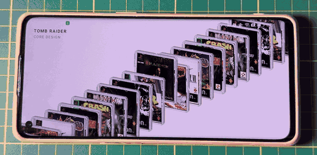

# KMP Odd Scroll

Odd scrolling styles for Compose Multiplatform — spirals, spheres, decks, a CD
rack, a gallery you can walk into. Each style is a single composable that takes
a list of items and owns its own layout, projection and gestures.

**Android · iOS · Desktop (JVM) · Wasm · JS** — common code throughout. A few
styles add an AGSL shader on Android 13+ and draw without it everywhere else.

<p align="center">
  
</p>

## Contents

- [Installation](#installation)
- [Styles at a glance](#styles-at-a-glance)
- Styles: [Infinite Spiral](#infinite-spiral) ·
  [Edge Distortion](#edge-distortion) · [Flex Carousel](#flex-carousel) ·
  [Infinite Menu](#infinite-menu) · [Card Sphere](#card-sphere) ·
  [Lift Stack](#lift-stack) · [CD Rack](#cd-rack) ·
  [Gallery Wall](#gallery-wall) · [Terrace](#terrace) · [Runway](#runway)
- [Running the demo app](#running-the-demo-app)
- [Demo GIFs](#demo-gifs)
- [Image credits](#image-credits)

## Installation

The library is `io.github.mejdi14:kmp-odd-scroll`. It is not on Maven Central
yet; until it is, include the `oddScroll` module as a project dependency:

```kotlin
// settings.gradle.kts
include(":oddScroll")

// build.gradle.kts of your shared module
kotlin {
    sourceSets {
        commonMain.dependencies {
            implementation(project(":oddScroll"))
        }
    }
}
```

It depends on `compose.foundation` only — no Material — so it doesn't pull your
app onto Material 3. Android needs API 24 or newer.

## Styles at a glance

Every style is called the same way: a list of items and a `Modifier`, usually
`Modifier.fillMaxSize()`. Those with a `state` take it from a
`remember…State()` function, which is also how a host drives them from its own
controls.

| Style | What it is | Platform extras |
| --- | --- | --- |
| [Infinite Spiral](#infinite-spiral) | a column of cards wound onto an endless spiral | — |
| [Edge Distortion](#edge-distortion) | an endless lattice that bends away at the frame's borders | fisheye and fringe on Android 13+ |
| [Flex Carousel](#flex-carousel) | an infinite row flowing through liquid glass at its edges | glass on Android 13+ |
| [Infinite Menu](#infinite-menu) | a sphere of tiles that turns the nearest to face you | — |
| [Card Sphere](#card-sphere) | flat graphic cards on a transparent sphere | — |
| [Lift Stack](#lift-stack) | a deck seen from above, a card lifting off to face you | — |
| [CD Rack](#cd-rack) | a row of jewel cases to open, take the cover out of and read the manual of | shaded plastic and disc on Android 13+ |
| [Gallery Wall](#gallery-wall) | paintings round a room, to walk up to, take apart and step inside | liquid glass and paper grain on Android 13+; Flip and Step inside need Android 10+ |
| [Terrace](#terrace) | a deck stacked in depth both ways from the front card | — |
| [Runway](#runway) | a colour-banded runway of raised card plinths curving up into the distance, tethered to a margin index | — |

"Platform extras" are drawn only where they are listed; everywhere else the
style looks flat in that one respect and behaves identically otherwise.

---

### Infinite Spiral

A column of cards wound onto a spiral, turning endlessly. Each card sits a fixed
step further down than the one before and a fixed turn further round. Nothing is
actually in depth — the cards stay on the plane, and the roundness comes from
where the turn puts them across the frame and how large the near side draws
them. The card at the middle is the largest and the sharpest; away from it they
shrink, soften and fade out.

```kotlin
InfiniteSpiralScroll(
    items = listOf(InfiniteSpiralItem(image, "Forest Path"), /* ... */),
    modifier = Modifier.fillMaxSize(),
    motion = SpiralMotion.Both,
)
```

| Parameter | Default | |
| --- | --- | --- |
| `motion` | `Both` | `Drift`, `Hand`, or both |
| `speed` | `0.55` | cards a second while drifting |
| `direction` | `Up` | which way the drift runs |
| `radius` | `170.dp` | how far the spiral swings across the frame |
| `cardWidth` / `cardHeight` | `100.dp` | card size |
| `verticalSpacing` | `60.dp` | step down between one card and the next |
| `perspective` | `1000.dp` | depth the near side is enlarged against |
| `cardsPerTurn` | `7` | cards in one full turn |
| `rotation` / `cardTilt` | `0` / `0` | turn of the spiral, lie of each card |
| `cardRadius` | `10.dp` | corner rounding |
| `centerScale` | `1.2` | how much larger the middle card draws |
| `edgeFade` / `edgeBlur` | `0.3` / `6.dp` | how the ends fade and soften |
| `grayscale` | `0` | drain the colour |

<details>
<summary>How it's drawn</summary>

Compose has no blur in common code, so the softening at the ends is a blurred
copy of each card made once — the picture laid down twenty-five times on a small
offset lattice and added together — cross-faded against the sharp one.

</details>

### Edge Distortion

An endless lattice of cards panned freely on both axes, bending away at the
borders of the frame with a fisheye and a colour fringe. It drifts diagonally on
its own and takes a drag, resuming the drift on release. There is no extent and
no edge — pan far enough and the pictures come round again.

> The border treatment is a single AGSL shader pass over the frame, so it needs
> **Android 13 (API 33) or newer**. Everywhere else — older Android, desktop,
> web, iOS — the lattice draws flat and behaves identically otherwise.

```kotlin
EdgeDistortionScroll(
    images = listOf(image, /* ... */),
    modifier = Modifier.fillMaxSize(),
)
```

| Parameter | Default | |
| --- | --- | --- |
| `background` | white | page colour behind the cards |
| `cardHeight` | `0.375` | card height, share of the viewport |
| `cardRatio` | `0.8` | card width / height |
| `gapX` | `0.333` | space between columns, share of card width |
| `gapY` | `0.267` | space between rows, share of card height |
| `corner` | `0.053` | rounding, share of the shorter side |
| `distortion` | `0.3` | how hard the borders bend; `0` is flat |
| `aberration` | `0.008` | fringe offset in uv; `0` drops it |
| `panSpeed` | `1.5` | lattice pixels per pixel of drag |
| `drift` | `(0.03, 0.015)` | idle movement per second |

### Flex Carousel

An infinite row of pictures that flows through invisible liquid glass at its
edges. With `fit = Natural` cards keep their own proportions and the row is a
run of unequal widths; any other `fit` draws them all at one size. Either way a
step along is half of this card plus the gap plus half of the next.
Position is a spring: flick, wheel and tap all arrive as a new goal. The faster
it runs, the narrower every card draws. Tap the centred card to open it.

> Like Edge Distortion, the glass is a single AGSL pass and needs **Android 13
> (API 33) or newer**; elsewhere the row runs undistorted and everything else is
> unchanged.

```kotlin
FlexCarouselScroll(
    items = listOf(FlexCarouselItem(image, "Forest Path"), /* ... */),
    modifier = Modifier.fillMaxSize(),
    lens = FlexLens.Liquid,
)
```

| Parameter | Default | |
| --- | --- | --- |
| `lens` | `FlexLens.Liquid` | glass shape; also `Ribbon`, `Vortex`, `Arch` |
| `cardHeight` | `0.5` | card height, share of the viewport height |
| `maxCardWidth` | `0.62` | widest a card may draw, share of viewport width |
| `gap` | `12.dp` | space between cards |
| `radius` | `0.dp` | corner rounding |
| `fit` | `Natural` | or `Portrait`, `Square`, `Landscape` |
| `squeeze` | `0.2` | how far cards narrow at full speed |
| `focusOnClick` | `true` | tap the centred card to open it |
| `focus` | `Auto` | where an opened card goes — `Beside`, `Centred`, or `Auto` |
| `autoplay` / `interval` | `false` / `4f` | step along on a timer |
| `captions` | `true` | title and counter |
| `intro` | `true` | the row rises into place |

**Opening a card.** On a landscape frame it grows into the middle first, and
only once it is there does it move over into the left half and give the right
half to its title and description. Closing retraces that: over to the middle,
then down into the row. The text lets itself in a piece at a time as the card
arrives — the title by the letter, the description by the word, each piece
rising into place behind the one before it. Closing takes it away at once,
without a reverse reveal to sit through. `FlexFocus.Centred` keeps it in the
middle throughout; on a portrait frame `Auto` stays centred, since there is no
room to put text next to a card worth looking at.

**Sizing.** Every size is a share of the bounds the row is given, including the
lens, so handing it a band rather than the whole screen is the way to make its
cards smaller — the demo gives it 62% of the height on a portrait screen and all
of a landscape one. `maxCardWidth` is the backstop underneath that: it holds the
widest card to a share of the width and brings `cardHeight` down with it, since
on a tall frame half the height is wider than the frame itself. A landscape
frame never reaches the cap.

### Infinite Menu

A sphere of tiles, dragged from any direction, that brings whichever tile ends
up nearest the front round to face you. Pictures repeat around the sphere, so it
reads as a surface rather than a list bent into a ball. Tiles turning away
shrink, desaturate and fade; the camera backs off while you handle it and draws
in again as it settles.

```kotlin
InfiniteMenuScroll(
    items = listOf(InfiniteMenuItem(image, "Forest Path", "Autumn woodland"), /* ... */),
    modifier = Modifier.fillMaxSize(),
)
```

| Parameter | Default | |
| --- | --- | --- |
| `tileCount` | `160` | tiles on the sphere, 6 to 400 |
| `tileSize` | `0.63` | tile size, share of its own patch of sphere |
| `roundness` | `0.2` | corner rounding, 0 square to 1 circular |
| `zoom` | `1.65` | how much of the frame the front tile fills |
| `pullBack` | `1.0` | how far the camera backs off while moving |
| `stretch` | `0.6` | smear along travel while spinning |
| `inertia` | `0.6` | how long a throw runs |
| `autoplay` | `3f` | seconds at rest before stepping on; `0` never |
| `grayscale` / `dim` | `true` / `0.5` | how the tiles behind are drained |
| `captions` | `true` | title and description of the front tile |

<details>
<summary>How it's drawn</summary>

Unlike the other two optical styles this one needs no shader anywhere — it is
all geometry, one image per tile, so it runs the same on every target.

</details>

### Card Sphere

A field of flat graphic cards on a transparent sphere. Drag, flick or scroll to
turn it; it coasts, then glides one of eight hero cards to the front. Double tap
flips the page between white and `#111`.

Each card carries one watercolour flower, dealt by a stride so every flower gets
an equal share of the field and no two neighbours draw the same one.

```kotlin
CardSphereScroll(
    flowers = listOf(image, /* ... */),
    modifier = Modifier.fillMaxSize(),
    theme = CardSphereTheme.Light,
    onSettle = { hero -> },
)
```

| Parameter | Default | |
| --- | --- | --- |
| `flowers` | — | plates dealt round the field; the heroes take the first eight |
| `theme` | `Light` | starting page colour |
| `allowThemeToggle` | `true` | double tap flips the page |
| `onSettle` | `null` | hero index, each time the field rests |
| `onThemeChange` | `null` | called when the page flips |

<details>
<summary>How it's drawn</summary>

The field itself is generated from a fixed seed, so the arrangement is the same
every run. Like Infinite Menu it needs no shader anywhere.

</details>

### Lift Stack

A deck of pictures laid flat in a stack and seen from above at a quarter turn.
It runs up through itself a card at a time — each one comes in at the bottom,
rides up four layers and fades off the top. Tap the top card and it lifts off
the deck and turns upright to face you, with its title let in underneath; tap
again and it plays back down into its slot. Drag it, flick it, or scroll to step
it on — except while a card is up, when the deck stays put.

```kotlin
LiftStackScroll(
    items = listOf(LiftStackItem(image, "Green Wheat Fields", "Vincent van Gogh"), /* ... */),
    modifier = Modifier.fillMaxSize(),
)
```

| Parameter | Default | |
| --- | --- | --- |
| `items` | — | cards in order; the deck repeats, so it has no end |
| `background` | `#F6F6F1` | page colour |
| `contentColor` | `#141414` | caption text |
| `markerColor` | `#D9443F` | the square that leads the caption |
| `captions` | `true` | title and credit of the standing card |
| `state` | intro of `7` | `rememberLiftStackScrollState(intro)` — cards run on first show; `0` opens at rest |

**State.** `LiftStackScrollState.step(by)` runs the deck on from a host's own
controls, and `locked` says whether a card is up and the deck is holding still.

<details>
<summary>How it's measured and drawn</summary>

The geometry and timing were measured off a recording of the reference rather
than eyeballed: a pinhole camera fitted to the resting stack (yaw 45°, looking
down 27°, fifteen card sides away), a layer gap of 0.274 card sides, a lift of
0.73 sides, and the reference's own curves for the run, the settle, the rise
and the turn.

Every card is one `drawImage` through its own exact projection — Compose's
`Matrix` carries the perspective terms on every target — so it needs no shader
and no strips anywhere.

</details>

### CD Rack

<p align="center">
  
</p>

A row of clear CD jewel cases standing on edge, seen from above and to the
left, running up and to the right across the frame. It slides along its own
length, and the case that comes to the slot in the middle rises out of the row,
with its title let in top left. Drag along the row (or across it — only the
part along it counts), flick to throw it, or scroll to step it a case.

**Taking a case out.** Tap a case to take it out: it comes to the slot, the
rest of the row clears off the screen either way, and it turns to face you and
comes forward — the single case below, to drag round and tap open. Open, an
Inspect button at the bottom takes its cover out: the paper lifts off the lid,
then turns over to its printed side and comes down under the case, which rises
to make room as it goes and shuts once the cover is clear. Wider than tall, the
cover comes to rest to the right of the case rather than under it, the open
case moving left as the cover moves right so its lid shuts clear of it. Back
from the cover out plays the whole thing in reverse.

**The manual.** Give the case a `manual` and the cover is the front of a
booklet: tap it and the cover folds open over the spine, the spread coming up
into the middle of the frame as the case goes up out of it. Swipe it, tap a
page or scroll to turn the leaves — each turn is one fold of the leaf over the
spine, its back mirrored onto it, after a sketchbook from another project of
mine. Each spread is a picture of the booklet lying open, a page either side of
its middle, and the last leaf shuts it on its back, which is also what the
cover shows from behind.

Down the right of the open booklet stands a ruler, a tick to a fraction of a
page, from the front through every spread to the back: drag its red playhead
and the booklet runs through them under the finger, the ticks swelling and
darkening around the playhead and the page riding beside it in a capsule. A
jump further than a leaf riffles there, a leaf at a time, slow at either end of
the run, quickest and motion-blurred in the middle, like the sketchbook's
opening riffle. The ruler's proportions are measured off a recording of a time
scrubber.

**Buttons and back.** While the booklet is open the one button is Exit, on the
left, which shuts it; otherwise Back is on the left and the way on on the right.
`CdRackScrollState.leave()` (the demo wires it to the system's back) shuts the
manual if it is open, slides the cover back up into the lid if it is out, shuts
the case if it is open, turns it back into the rack and brings the row in again.

```kotlin
CdRackScroll(
    items = listOf(
        CdRackItem(
            disc, "Tekken 3", "Namco",
            cover = front,
            manual = { CdManual(spreads = loadSpreads(), back = loadBack()) },
        ),
        /* ... */
    ),
    modifier = Modifier.fillMaxSize(),
)
```

Each `CdRackItem` has the disc's `image`, a `title` and `artist`, an optional
`cover` slipped in under the lid's glass, and an optional `manual` — a
suspending loader for the booklet behind the cover, called off the main thread
only for the case that is out: a `CdManual` of its `spreads`, each a 2:1
picture of it lying open on a clear ground, spine down the middle, and its
`back`.

| Parameter | Default | |
| --- | --- | --- |
| `items` | — | cases in order; the rack repeats, so it has no end |
| `background` | white | the backdrop; the plastic is shaded for a pale one |
| `contentColor` | `#111114` | caption text |
| `captions` | `true` | title and artist of the case in the slot |
| `inspectLabel` | `"Inspect"` | the forward button's label on the open case, which takes its cover out; `null` for no step buttons at all |
| `pageScrubber` | `true` | the ruler down the right of the open manual whose playhead drags it from its front through its spreads to its back |
| `exitLabel` | `"Exit"` | the one button's label while the manual is open with its `pageScrubber`, which shuts it |
| `backLabel`, `openLabel`, `nextLabel` | `"Back"`, `"Open"`, `"Next"` | the other labels of the Back and forward buttons that walk the case out through its steps |
| `state` | intro of `4` | `rememberCdRackScrollState(intro)` — cases slid on first show; `0` opens at rest |

**State.** `CdRackScrollState.scrollTo(index)` and `step(by)` drive it from a
host's own controls, `inspect(index)` takes a case out, `leave()` puts it back,
`slotted` is the case in the slot and `inspecting` whether one is out.
`canInspectCover` is true while the case out is open with its cover in, and
`inspectCover()` takes the cover out — for a host that brings its own button.
With the cover out, `case.turnPage(by)` and `case.closeManual()` leaf through
its manual, and `case.manualPage` is the spread it is open at (`-1` shut). The
buttons walk `step` — `0` shut, `1` open, `2` cover out, then a step per spread
of the manual — with `stepForward()`, `stepBack()` and `lastStep` for a host's
own.

<details>
<summary>How it's measured and drawn</summary>

Every case is the 3D case of `CdCase`, drawn after Ann Nguyen's WebGL
[CD case](https://github.com/annnguyentt/vibe-coding/tree/main/cd-case). The
rack's three measured angles turn out to be one turn of it, exactly — tipped
back 0.310 rad and turned 0.534 rad left, the cases standing face to face along
their own axis, 71.9 mm apart — seen through a camera dollied 24 times out
with its lens lengthened to match, which flattens the row to the reference's
orthographic look. So each case is drawn once at that turn, shaders and all,
and then only moved; the one taken out is drawn live, while the camera comes
back in.

The rack was measured off a recording of a row of cassettes, which is why the
numbers below talk in tapes. The top-left corner of every tape, pooled over 270
frames, falls on one line with one pitch and one number per frame to 1.1 px, so
the rack is a single scalar:

- the row runs at 27.3°, a tape every 0.322 tape widths, with no perspective
  to speak of (0.05% a tape), so every tape is the same shape on screen;
- the slotted tape stands 0.342 widths proud, straight up, as a fixed function
  of its distance from the slot — flat within 0.08 tapes, gone by 1.0, a
  smoothstep between (1.9 px residual on a 50 px lift; a timed per-tape lift
  fits no better than 7 px);
- nothing turns (top edges agree to 0.6°), grows or fades; each tape sits a
  fixed 0.018 widths off the line, the same every time it comes round, and a
  light over the slot lifts its shell 18%;
- a throw leaves at the finger's speed on `cubic-bezier(0.283, 0.501, 0.698,
  0.955)`, a run from rest is `cubic-bezier(0.280, 0.027, 0.248, 0.935)` for
  0.664 s × √tapes — each within 0.6 px of the reference's own runs.

</details>

#### One case: `CdCase`

The case the rack takes out, on its own: on its white studio wall, idling with
a slow sway, the disc turning inside. Drag it to turn it (it springs back when
let go); tap it to open it — it turns right round as the lid swings out to its
left on the reference's own hand-keyed curves — and tap again to shut it.

```kotlin
CdCase(
    art = image,
    modifier = Modifier.fillMaxSize(),
)
```

| Parameter | Default | |
| --- | --- | --- |
| `art` | — | printed across the disc, its middle square to the disc's width |
| `cover` | `null` | slipped in under the lid's glass, its middle square filling the lid; `null` leaves it clear |
| `background` | white | the backdrop; the plastic is shaded for a pale one |
| `spin` | `true` | turn the disc inside the case |
| `state` | — | `rememberCdCaseState()`; `open()`, `close()`, `toggle()` and `isOpen`; open, `inspectCover()` takes the cover out from under the lid and `returnCover()` puts it back, with `coverOut` true in between |

<details>
<summary>How it's drawn</summary>

It is the reference's geometry and its studio, carried over:

- the camera is a 28° lens far enough back for the case to fill 60% of the
  height, and every piece of the case — floor, rails and ribs, disc, hub, tab,
  lid — is flat in its own frame, so each is baked once and drawn through its
  own exact projection, back to front as the case faces. The walls round its
  edge and the hinge's knuckles are drawn as the camera sees them each frame,
  and its shadow falls on the wall behind along the reference's light;
- on Android 13 and up the plastic and the disc are shaded a pixel at a time in
  AGSL, after the reference's own shaders: its analytic studio of softboxes and
  flags, Fresnel at every surface, rods that refract the view through a round
  section and bend the page and the dark room into it, sheets that throw back
  the softboxes' glare, and the disc's diffraction rainbow, three orders of the
  spectrum along its tracks. The rods' sparks of the studio's small lamps are
  found at half resolution, and the brightest of them, the ones no neighbour
  outshines, are streaked across and down into the reference's four-point stars,
  a pale blue over the white. Elsewhere the same pieces are drawn from a baked
  look, with the rainbow and the lid's glare worked out per frame for the case's
  turn.

</details>

### Gallery Wall

Paintings hung round the inside of a room — a back wall facing you, side walls
running towards you, rounded corners between — that slide along the walls past
you, each with its label on the wall underneath. A painting comes in down the
right-hand wall, bends round the corner, crosses the back and goes out down the
left. Drag along it or scroll, and the hang springs after and comes to rest
with a painting in the middle; tap a painting to bring it to the middle. The
room opens with a walk in from the doorway.

**Taking a look.** Two seconds after it stops, a Take a look button walks you
up to the painting in the middle — two seconds of a visitor's approach, steps
and all. As the walk starts the painting comes off the wall's curve and hangs
flat, square on; nearly there, the paintings either side slide away down the
walls and out of the frame.

**Inspect and Flip.** Once there, Exit (bottom left) steps back and Inspect
(bottom right) takes the painting apart: the frame cracks along its mitres and
each of its four sticks flies off past its own edge of the screen while the
label fades, then the glass slides straight up and out of the top — on Android
13 and up its liquid edges bending the painting as they cross it. With both
gone, Flip (bottom right) turns the bare painting over like a sheet of paper: a
crease sweeps in from the lower left corner with ripples settling behind it,
the sheet turning about an axis that swings from the diagonal to upright, left
side first, until it lies with its back showing — the item's `back`, or the
painting again without one — and on Android 13 and up the paper's grain
showing as it turns. Flip again turns it back. Stepping back puts the glass and
the frame back on.

**Step inside.** Up close, framed or bare, Step inside (bottom right, above
Inspect) goes into the painting. Every point of it is pushed back along its own
line of sight to the depth the scene would have — so from where you stand it
still looks exactly like the flat painting — then the room fades to dark round
it and the eye goes in, a little forward and a little narrower: the near ground
swells past you while the distance barely moves. Where the depth jumps the sheet
comes apart, and behind it is a second sheet: the painting with its near things
painted out a little way in from their edges, in the colours round them, at the
depth of what is behind — so a figure slides across a distance that goes on
behind it, a shade darker in its shadow, instead of tearing onto the dark.
Inside, a drag turns the head and leans it the same way so near things slide
across far ones, a scroll walks in or back, and the head drifts a little on its
own; Exit, or the system back, steps back out. The depth comes from the item's
`depth` map if it has one, or is guessed from the painting — the ground running
away up the canvas, the distance hazier and bluer than what is near, the sky
furthest, smoothed within each patch of colour so it jumps along outlines. It
is one textured triangle mesh a frame, its arrays written in place, so it needs
Android 10 or later, like Flip.

```kotlin
GalleryWallScroll(
    items = listOf(
        GalleryWallItem(image, "Wheat Field with Cypresses", "Vincent van Gogh", "1889", "Oil on canvas"),
        /* ... */
    ),
    modifier = Modifier.fillMaxSize(),
)
```

| Parameter | Default | |
| --- | --- | --- |
| `items` | — | paintings in order; the hang repeats, so it has no end |
| `background` | `#FFFFFF` | the wall |
| `contentColor` | `#1A1A1A` | the labels; all but the title are set in it at 45% |
| `frame` | `null` | `GalleryWallFrame()` hangs each painting in a frame — see [Frames and glass](#frames-and-glass); `null` hangs them flat and bare |
| `lookLabel` | `"Take a look"` | the button that walks up to a painting; `null` for none |
| `exitLabel` | `"Exit"` | the button, bottom left up close, that steps back; `null` for none, when a tap anywhere does |
| `inspectLabel` | `"Inspect"` | the button, bottom right up close, that takes the frame and then the glass off; `null` for none |
| `flipLabel` | `"Flip"` | the button, bottom right once the frame and glass are off, that turns the painting over and back; `null` for none |
| `stepInsideLabel` | `"Step inside"` | the button, bottom right up close above Inspect and Flip, that goes into the painting; `null` for none |
| `state` | — | `rememberGalleryWallScrollState()`; `walkIn = false` skips the walk in from the doorway |

**Items.** `GalleryWallItem.scale` is a painting's height against the tallest
(1), `GalleryWallItem.back` what is on the back of its canvas when it is turned
over, stretched to its size, `GalleryWallItem.depth` a depth map of it for
stepping inside — white near, black far, any size, what a single-image depth
model such as Depth Anything writes out — and `GalleryWallItem.scene` a
`GalleryWallScene(geometry, textures)` to walk into instead: the scene file
(its camera, route, look bounds and layers, documented on the class) and the
textures its layers name. A `GalleryWallItem` can also carry a `frame` of its
own in place of the one given to the wall, so each painting can hang in a
different frame.

**State.** `GalleryWallScrollState.scrollTo(index)` brings a painting to the
middle from a host's own controls, and `centred` is the one there. `canLook`
turns true two seconds after the hang comes to rest; `look()` walks up to the
painting and `leave()` steps back, with `looking` true in between — a host can
wire the system back to it with
`BackHandler(enabled = state.looking) { state.leave() }`.
Up close `arrived` is true, and while the frame is still on so is `canInspect`;
`inspect()` takes it and the glass off, and `inspected` stays true until
`leave()`. `canStepInside` is true up close while the painting lies face up and
still; `stepInside()` goes into it, `inside` is true until `leave()`, which
steps back out of the painting first and from it the next time. Once both are
out of sight `canFlip` turns true and `flip()` turns the painting over, or back.

#### Frames and glass

`GalleryWallFrame()` hangs each painting in a walnut frame — four mitred sticks,
the grain running along each — that stands 4.5 cm off the wall (against a
metre-tall painting). The edge shows as the wall turns away, and a soft shadow
falls behind. The painting sits 1.5 cm back inside it, so the inside of the
moulding shows round it at an angle.

With `carving = 1f` it is hand-carved, every piece a little off true, in one of
four `ornament`s:

- `Classical` (the default) cuts a rope twist round the outer edge, egg and dart
  along the face, bead and reel at the sight edge and a rosette over each mitre;
- the baroque ones swell the moulding into a big torus over a deep cove —
  `Shell` runs acanthus along it towards the middle of each side, with pearls at
  the sight edge and a scallop shell between C-scrolls over each corner and each
  middle;
- `Acanthus` runs the leaves clockwise all the way round, with a spray of leaves
  round a flower over each corner and bead and reel at the sight edge;
- `Gadroon` gadroons the torus, with C-scrolls curling into each corner round a
  small shell and a fan of leaves at each middle.

`gilt = true` lays gold leaf over any of them instead of bare wood (`color` is
the gold, best with `grain = 0f`), rubbed through to the red bole on the high
edge.

The painting is behind glass that throws back more of the wall the further the
wall turns away (Fresnel), with the doorway behind you as a soft glow that stays
put as the paintings slide under it; `glass = false` leaves it open. On Android
13 and up the glass is liquid glass, an AGSL shader drawn in the painting's own
coordinates after Kyant's AndroidLiquidGlass (Apache 2.0): its square-cornered
edges run under the moulding, where they bend the painting under them along a
quarter circle and split it into colours, with 1.5x vibrancy, a faint white
tint and a thin rim lit from the corners, and show as the glass slides away
once the frame is off.

#### Walking into a scene

A painting can instead be rebuilt as a place, `GalleryWallItem.scene`, and then
Step inside walks into it. The demo does this for *The Cliff Walk* and *Poppy
Field*.

*The Cliff Walk*'s coast is laid out round the spot it was painted from — a 55°
camera tilted 6° down to put the horizon at a third of the way down — as a
sloping meadow, the headland's wall, the rock across the cove as a tapered mass,
a flat sea and a sky dome, with the figures and sails on their own cards and
grass standing up off the meadow. Each surface carries the painting's own paint
where it shows and paint carried on from round it where it does not: the sea
and sky past the edges, the sea behind the headland, the grass behind the
figures, the rock's far side. From the entry pose the scene is the painting;
stepping in, the room goes dark, the painting gives way to the scene with
nothing moving, and the eye walks 2.8 s along a route towards the water —
through the frame, which stays put in the scene as a window, so it grows only
as the eye goes up to it. A drag turns up to 25° either way — right towards the
cliff, left out to sea — and tilts 8° down or 10° up; a scroll walks on or back
along the route; the sea's brushwork drifts over it once in; Exit walks back
out. It is one textured mesh per layer, about 33,000 triangles in all, drawn
back to front.

*Poppy Field* is seen from 2.7 m up — the woman in the foreground has her head
well below the horizon — over a low poppy hill on the left whose crest, 18 m
off, carries the trees and the second woman and child, and a flat field on the
right running 190 m to the far tree line and the house, which stand on a band
at that distance so the field slides under them as you walk. The walk goes 5 m
up the hill's foot, past the near woman and child; turning left shows the
poppies carried on along the hill and more of its trees along the crest,
turning right the field and the tree line carried on past the frame.

What the frame does not show there is quilted rather than stretched: each
block of it is the piece of the painting that best agrees with what already
lies round it, cut from rows where the paint is the size it should be at that
distance, and joined along the line where the two differ least — so the
brushwork out there is Monet's own, at its own size, and no stroke is blended
with another. The sky, the ground and the far tree line share one sheet that is
the painting pixel for pixel inside the frame and runs on evenly in angle
outside it.

<details>
<summary>How it's measured and drawn</summary>

Measured off a recording of the reference rather than eyeballed. How tall a
painting stands at each column of the screen is one fixed curve for every
painting in every frame, bar its own height — 475,000 columns over 640 frames
to 0.44 px — so the wall stays put and the whole hang is a single scalar
(every painting placed to 1.8 px). In heights of the tallest painting:

- the eye is 6.95 from the back wall, level with the paintings' middles, with a
  focal length of 1.40 frame widths;
- the side walls stand 1.10 either side of the middle, joined to the back wall
  by corners of radius 0.64 (the wall's profile to 0.37 px; the focal length is
  pinned by the paintings holding their shape round the corner, to 1%);
- paintings hang 0.56 apart edge to edge, the same on every stretch of wall to
  2.6%, at heights from 0.72 to 1;
- nothing turns, grows, fades or dims on the way round — size holds to 0.1%,
  brightness to 1.4% — and the corners are square;
- after a swipe the hang settles on a critically damped spring, ωn = 6.74 a
  second (`spring(dampingRatio = 1f, stiffness = 45.5f)`), to 1.3 px over seven
  let-gos, and coasts no further than a spring trailing the input would.

Each painting is drawn once, label and all, into a bitmap and then through its
own exact projection — one `drawImage` for each flat stretch of wall it is on
and a dozen chords to a corner — so it needs no shader. Flip is one textured
mesh a frame, the paper fold carried over from a GL study, drawn with
`drawVertices` (Android 10 and up; the button stays hidden below).

</details>

### Terrace

A deck stacked in depth both ways from the card at the front: the cards before
it step back above, the ones after it below, each smaller than the one in
front, so all that shows of them is a band along the edge — a terrace either
side of the front card, with its index to the left and its title to the right.
Run it on and the front card shrinks back into the bands above while the first
band below grows out to take its place; the two pass in front of each other
halfway. Drag up or down, flick to throw it, scroll a card a notch, or tap a
band to bring that card to the front.

```kotlin
TerraceScroll(
    items = listOf(TerraceItem(image, "Sounds", "Marlborough Sounds"), /* ... */),
    modifier = Modifier.fillMaxSize(),
)
```

| Parameter | Default | |
| --- | --- | --- |
| `items` | — | cards in order; the stack repeats, so it has no end |
| `background` | `#FFFFFF` | page colour |
| `contentColor` | `#141414` | captions; the index and subtitle are set in it at reduced strength |
| `shadowColor` | `#000000` | the shadow each card throws onto those behind it |
| `captions` | `true` | index to the left of the front card, title and subtitle to its right |
| `depth` | `3` | levels shown either side of the front card |
| `state` | — | `rememberTerraceScrollState()` |

**State.** `TerraceScrollState.scrollTo(index)` and `step(by)` drive it from a
host's own controls, and `front` is the card at the front.

<details>
<summary>How it's measured and drawn</summary>

Measured off a recording of the reference rather than eyeballed. The width of
every card and the outer edge of every band, pooled over 175 frames, collapse
onto one number per frame and five constants to 0.20 px (max 0.99 px over
2,409 edges), so the stack is a single scalar. In card widths, a card `d`
levels from the front:

- is scaled by 0.801^|d| (± 0.0005) and centred 0.207·d below the middle; the
  card is 1.384 tall. Interpolating between fixed slots instead fits only to
  0.51 px with six more numbers, and its slots come out at 0.8, 0.8² and 0.8³;
- holds its x-centre to 0.06 px, turns by no more than 0.18°, keeps its size to
  0.13% at the front, and has square corners (any radius is under 0.01);
- is never dimmed — a band reads darker one level back only because the card in
  front throws a shadow onto it: a gaussian 0.070 soft, dropped 0.065 and 20%
  dark, to 2/255 of the page;
- settles on a first-order approach to the nearest card, 5.47 a second (5.03
  to 5.97 over five settles, 0.3 px each). It is not a spring: a free spring
  fit comes back critically damped with no swing, and one from rest would have
  to start eight frames before anything moves.

A card and one shared, baked shadow are each a single `drawImage` placed by a
transform, so the stack is fourteen draws a frame and needs no shader.

</details>

### Runway

A colour-banded 3D perspective runway of raised card plinths that runs away from
the bottom corners of the frame and curves upward into the distance at the top,
flanked by a 500-px coordinate ruler, wireframe architectural blocks and
equations on the dark floor, and an eleven-section index down the left margin
whose active dot throws curved Bezier spline tethers to the cards and feature
nodes passing on the runway. Drag up or down, flick to coast and settle, scroll
with the wheel, tap any section in the left index to jump to it, or tap the
`start ↑` plinth at the 44,071-px finish line to fold it and launch.

```kotlin
RunwayScroll(
    items = listOf(
        RunwayItem(image, "Shop skill for any agent", "Give agents discovery and checkout."),
        /* ... */
    ),
    modifier = Modifier.fillMaxSize(),
)
```

| Parameter | Default | |
| --- | --- | --- |
| `items` | — | raised card plinths placed along the runway sections |
| `sections` | `DefaultRunwaySections` | the eleven colour-coded runway sections (`Agentic` to `Developer`) |
| `background` | `#050507` | dark blueprint ground colour |
| `state` | `autoplay = true` | `rememberRunwayScrollState(autoplay, initialScrollPx)` |

**State.** `RunwayScrollState.scrollToSection(index)` and `scrollToPx(target)`
drive the runway from a host's own controls, `triggerLaunch()` runs the finish
plinth's fold-and-launch sequence, and `activeSection` reports the section
currently passing the middle of the frame.

<details>
<summary>How it's measured and drawn</summary>

Measured off the 752 post-intro frames (`t = 2.000 s .. 27.033 s`) of the
reference recording rather than eyeballed. Pooling the 10 colour-band section
boundaries (292 observations) and 17 flat card tracks (34 horizontal edges,
1,132 edge observations, 606 pose observations) collapses the entire scene onto
one scalar scroll coordinate `S(t)` per frame (calibrated to the HUD's `page W =
993 px` and `to the finish: ↑ 44,071 px`):

- the runway is centred at `0.5000` of the frame width to 0.25 px RMS (max
  0.42 px); its width narrows from a flat tilted plane in the foreground
  (`dw/dy = 0.798` below `y = 0.55 H`) up a concave ramp that turns to face the
  camera at the top edge (`w(0) = 0.3812 W`, `dw/dy → 0`), fitted across all
  1,020 unclipped scanlines to 0.59 px RMS;
- card plinths ride the inner rails `u ∈ [-0.369, +0.369]` (`0.738` of the
  runway width, with a `0.0148` centre gutter between paired half-cards) and
  stand `0.0201` runway widths (`20.0 px` on `1080 px`) proud of the floor,
  placing card horizontal centres to 0.41 px RMS, card vertical centres to
  0.89 px RMS (median 0.19 px), and section boundaries to 0.92 px RMS (median
  0.17 px);
- nothing turns (`θ = 0.00°`, RMS `0.34°`), dims or changes intrinsic size on
  the way up the ramp — section colours hold to `2.2%` across depth and card
  panels to `2.3%`;
- the reference tour runs in two main segments separated by a 0.27 s hold at
  `Developer` (`S = 36,321 px`): a 12.87 s cruise-and-deceleration (`CubicBezier(0.129, 0.100, 0.886, 0.900)` into `CubicBezier(0.616, 0.912, 0.861, 0.976)`, 6.44 px RMS) followed by an 8.83 s run through `Developer` that settles at `44,071 px` on `spring(dampingRatio = 0.7907f, stiffness = 275.37f)` (`ωn = 16.59 rad/s`, 1.07 px RMS).

Each card image is baked once and drawn through its exact four-corner projective
`Matrix` — one `drawImage` per visible plinth — so it runs in common code on
every target without shaders or strip subdivision.

</details>

---

## Running the demo app

The demo app in `shared/` shows every style from one gallery; the system's back
returns to it. Run it from the IDE's run widget, or:

| Target | Command |
| --- | --- |
| Android | `./gradlew :androidApp:assembleDebug` |
| Desktop | `./gradlew :desktopApp:run` (hot reload: `./gradlew :desktopApp:hotRun --auto`) |
| Web (Wasm) | `./gradlew :webApp:wasmJsBrowserDevelopmentRun` |
| Web (JS, older browsers) | `./gradlew :webApp:jsBrowserDevelopmentRun` |
| iOS | open [`iosApp`](./iosApp) in Xcode and run it from there |

Tests: `./gradlew :shared:jvmTest`, `:shared:testAndroidHostTest`,
`:shared:wasmJsTest`, `:shared:jsTest` or `:shared:iosSimulatorArm64Test`.

| Module | |
| --- | --- |
| [`oddScroll`](./oddScroll) | the library |
| [`shared`](./shared/src) | the demo app's UI, shared by every target |
| [`androidApp`](./androidApp), [`desktopApp`](./desktopApp), [`webApp`](./webApp), [`iosApp`](./iosApp) | thin entry points that call `App()` from `shared` |

## Demo GIFs

The recordings in [`docs/demos`](./docs/demos) are made with
[`scripts/demo-gif.sh`](./scripts/demo-gif.sh), which keeps them sharp at
640 px while storing only what moves from frame to frame:

```bash
scripts/demo-gif.sh recording.mov docs/demos/cd-rack.gif 3040:1480:400:420
```

The third argument is an optional crop in source pixels (`W:H:X:Y`), the fourth
an optional width (640 by default). Size goes with length — about 0.4 MB a
second of phone recording — so keep clips short. The script explains the
settings.

## Image credits

### Photographs

Infinite Spiral and Edge Distortion use photographs from
[Unsplash](https://unsplash.com), under the
[Unsplash License](https://unsplash.com/license). Cut to 1200x600 and bundled as
Compose resources.

| File | Photographer |
| --- | --- |
| `wide_sounds.jpg` | [Samuel Harrington](https://unsplash.com/photos/1791681403982-fe65ea53288f) |
| `wide_falls.jpg` | [Ingrid Eich](https://unsplash.com/photos/1767930704291-a12b91e5a261) |
| `wide_peaks.jpg` | [Maciej Marko](https://unsplash.com/photos/1790019852739-349585111186) |
| `wide_forest.jpg` | [Wolfgang Hasselmann](https://unsplash.com/photos/1788695968738-3c2818047036) |
| `wide_basalt.jpg` | [Adrien Olichon](https://unsplash.com/photos/1762763955129-0ad8692095ce) |
| `wide_towers.jpg` | [Heye Jensen](https://unsplash.com/photos/1790313157313-cbc2c66a61ab) |

The `grid_*.jpg` set is the same six photographs, cut 800x1000 for the portrait
cards of the Edge Distortion gallery; Terrace stacks the same cuts.

Flex Carousel uses museum scans of paintings, also from Unsplash and under the
same licence, cut 800x600 for its 4:3 cards. Lift Stack uses the same six, cut
square.

| File | Scanned by |
| --- | --- |
| `art_wheatfield.jpg` | [National Gallery of Art](https://unsplash.com/@ngadc) |
| `art_farmhouse.jpg` | [National Gallery of Art](https://unsplash.com/@ngadc) |
| `art_night.jpg` | [Birmingham Museums Trust](https://unsplash.com/@birminghammuseumstrust) |
| `art_cowherd.jpg` | [The Metropolitan Museum of Art](https://unsplash.com/@themet) |
| `art_village.jpg` | [Birmingham Museums Trust](https://unsplash.com/@birminghammuseumstrust) |
| `art_cypresses.jpg` | [Tofan Teodor](https://unsplash.com/@tofanteodor) |

### Paintings

Gallery Wall hangs fourteen `museum_*` paintings instead, each cut 1200x800
(3:2, so every one hangs the same height and one and a half times as wide) from
a 1,800 px or larger scan on Wikipedia / Wikimedia Commons: *Sunflowers*,
*Boating*, *Flaming June*, *Water Lilies and Japanese Bridge*, *The Roses of
Heliogabalus*, *Little Girl in a Blue Armchair*, *The Kiss*, *Almond Blossoms*,
*Luncheon of the Boating Party*, *The Cliff Walk at Pourville*, *The Birth of
Venus*, *Poppy Field*, *Lady with a Fan* and *Strolling along the Seashore*. The
reuse terms of each scan are on its Commons page.

`museum_cliff_walk_back.webp`, the back of *The Cliff Walk*, is an illustrated
note made for the demo — Monet's portrait, notes and a sketch of the cliff in
the style of a letter — not a scan of anything of his.
`museum_poppies_back.webp`, the back of *Poppy Field*, is another from
Argenteuil in 1873 on the same paper turned end for end: the cliff note's ink
lifted off it, notes in a hand set to match, a pencil study taken off the
painting with the poppies in red chalk and the parasol in blue, paint tried at
the corner, and the portrait, its caption and the signature carried over from
the first. Both sides of those two are WebP, each cut to its note's worn,
ragged outline (mirrored on the front, which it is the back of) with the paint
rubbed off the front's edges and corners down to the same browned paper.

Each painting has a `museum_*_depth.png` beside it, 600x400, white near and
black far, for stepping inside it: worked out from the 1200x800 cut by
[Depth Anything V2 Small](https://huggingface.co/depth-anything/Depth-Anything-V2-Small-hf)
(Apache 2.0 — the larger Depth Anything V2 models are non-commercial, so keep
to the small one), its relative depth stretched so the nearest and farthest
hundredth fill the range.

*The Cliff Walk* also has a scene to walk into: `files/museum_cliff_walk_scene.bin`
lays it out, and `museum_cliff_walk_far.webp` (sky and sea), `_ground`, `_cliff`,
`_cards` (figures, sails and grass) and `_strokes` (the sea's brushwork) paint
it. *Poppy Field* has the same, `files/museum_poppies_scene.bin` with
`museum_poppies_far.webp`, `_ground`, `_band` (the far tree line) and `_cards`
(the hill's trees and the four figures). All of them are cut from the 1200x800
cut of the painting and its depth map: the painting traced into regions, the
ground fitted to it, and the paint it does not show carried on from the paint
round it — pieces of the painting itself, quilted, for *Poppy Field* — none of
it is new art.

### Illustrations

The `flower_*.jpg` set used by Card Sphere was cut out of two watercolour flower
collection sheets from [Freepik](https://www.freepik.com) — each flower found as
its own run of ink on the paper, its neighbours painted back out, and the result
framed to the card's 4:5.

The `movie_*.jpg` set used by Infinite Menu is thirty silent-era film posters,
high-resolution scans from Wikipedia/Wikimedia, cut square from the top and
scaled to 640x640 for the sphere's tiles. Posters are copyrighted by their
studios and shown here only to illustrate the demo, so swap them for your own
artwork before using this anywhere real.

**Neither set is covered by the licences above.** Freepik's free licence wants
attribution and does not allow the flowers to be redistributed on their own, so
swap them for your own artwork before using this anywhere real, or hold a
Freepik licence that covers it.

### Game artwork

CD Rack's `ps1_disc_*.webp` are the disc labels of ten European PlayStation
releases, cut square and scaled to 640 px: community scans from the
[LaunchBox Games Database](https://gamesdb.launchbox-app.com). The artwork
belongs to each game's publisher and is shown here only to illustrate the demo,
so swap it for your own before using this anywhere real.

The `ps1_manual_*.webp` are each game's English instruction booklet pictured
whole: its `front` and `back` at 720 px squares, and five `spread`s of it lying
open at 1440 × 720, ten interior pages from the PAL and NTSC scans of
[Emu-Land](https://www.emu-land.net/library/manuals/psx) and the PS1 RPG manuals
collection. The manuals belong to each game's publisher, under the same
terms as the disc labels. Metal Gear Solid's is an expanded manual of
thirteen spreads, twenty-six pages, scaled down the same way.
