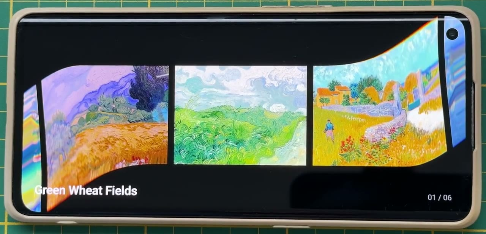
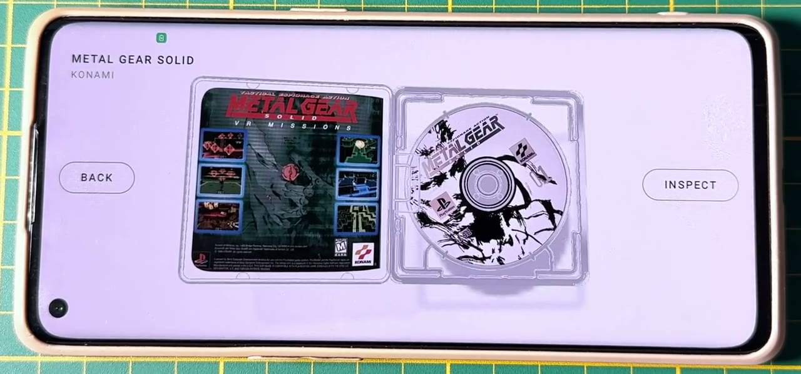

<div align="center">

# KMP Odd Scroll

Odd scrolling styles for Compose Multiplatform.<br>
Each one is a single composable that takes a list and owns its layout, projection and gestures.

**Android · iOS · Desktop · Wasm · JS**

</div>

<br>

## Flex Carousel

An infinite row of paintings that flows through liquid glass at its edges. Flick,
scroll or tap to move it; tap the centred card to open it beside its text.

<p align="center">
  <a href="media/flex-carousel.mp4">
    
  </a>
</p>

```kotlin
FlexCarouselScroll(
    items = listOf(FlexCarouselItem(image, "Forest Path"), /* ... */),
    modifier = Modifier.fillMaxSize(),
)
```

| Parameter | Default | |
| --- | --- | --- |
| `lens` | `Liquid` | glass shape: `Liquid`, `Ribbon`, `Vortex`, `Arch` |
| `fit` | `Natural` | card proportions, or `Portrait`, `Square`, `Landscape` |
| `squeeze` | `0.2` | how far cards narrow at full speed |
| `autoplay` | `false` | step along on a timer |

The glass is an AGSL shader and needs Android 13+; everywhere else the row runs
undistorted.

<br>

## CD Rack

A row of jewel cases running across the frame. Tap one to take it out, open it,
slide the cover from under the lid and leaf through its manual.

<p align="center">
  <a href="media/cd-rack.mp4">
    
  </a>
</p>

```kotlin
CdRackScroll(
    items = listOf(CdRackItem(disc, "Tekken 3", "Namco", cover = front), /* ... */),
    modifier = Modifier.fillMaxSize(),
)
```

| Parameter | Default | |
| --- | --- | --- |
| `background` | white | the backdrop; the plastic is shaded for a pale one |
| `captions` | `true` | title and artist of the case in the slot |
| `pageScrubber` | `true` | ruler that scrubs through the open manual |
| `state` | intro of `4` | `rememberCdRackScrollState(intro)` |

Shaded plastic and the disc's rainbow need Android 13+; elsewhere the same case
is drawn from a baked look.

<br>

## Install

Not on Maven Central yet — include the module as a project dependency:

```kotlin
// settings.gradle.kts
include(":oddScroll")

// build.gradle.kts
commonMain.dependencies { implementation(project(":oddScroll")) }
```

Depends on `compose.foundation` only, no Material. Android needs API 24+.

## Run the demo

```bash
./gradlew :desktopApp:run                         # desktop
./gradlew :androidApp:assembleDebug               # android
./gradlew :webApp:wasmJsBrowserDevelopmentRun     # web
```

For iOS, open [`iosApp`](./iosApp) in Xcode.

## Credits

Flex Carousel's paintings are museum scans from [Unsplash](https://unsplash.com)
([licence](https://unsplash.com/license)) by the
[National Gallery of Art](https://unsplash.com/@ngadc),
[Birmingham Museums Trust](https://unsplash.com/@birminghammuseumstrust),
[The Metropolitan Museum of Art](https://unsplash.com/@themet) and
[Tofan Teodor](https://unsplash.com/@tofanteodor).

CD Rack's disc labels come from the
[LaunchBox Games Database](https://gamesdb.launchbox-app.com) and its manuals
from [Emu-Land](https://www.emu-land.net/library/manuals/psx). The artwork
belongs to each game's publisher and is shown only to illustrate the demo — swap
it for your own before using this anywhere real.
